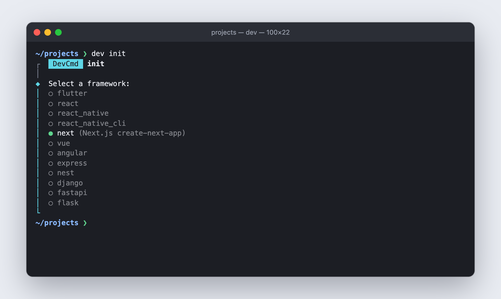
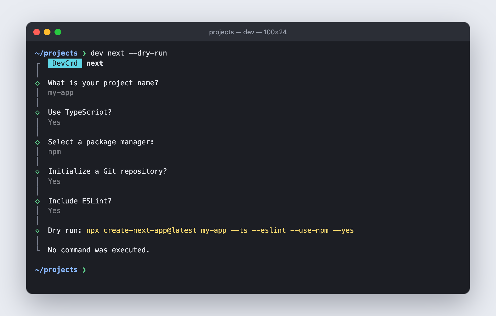
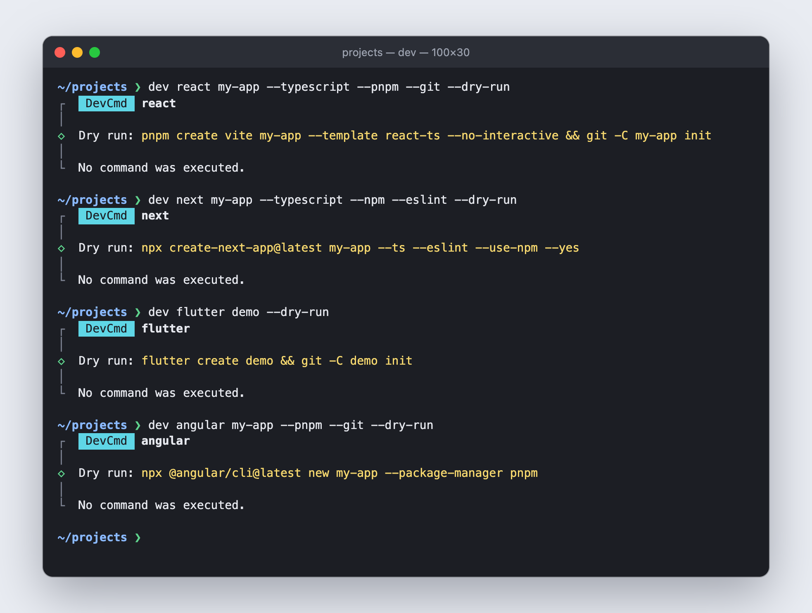
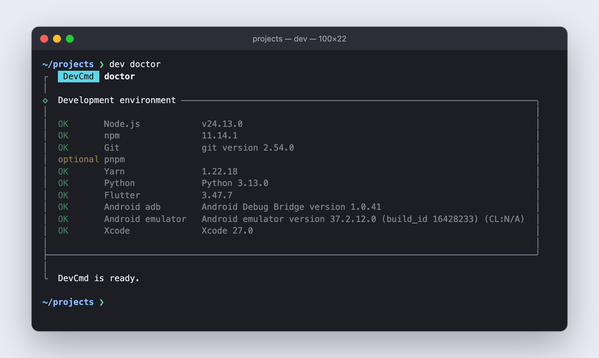
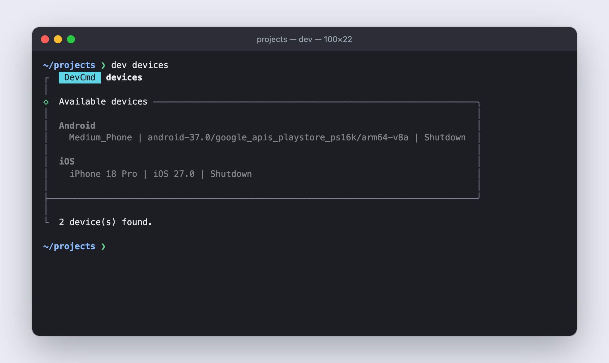
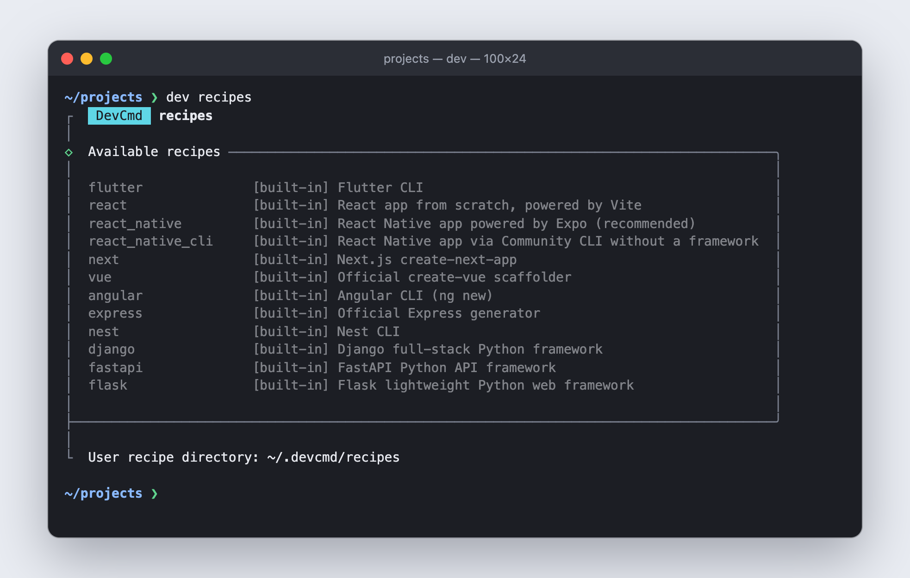
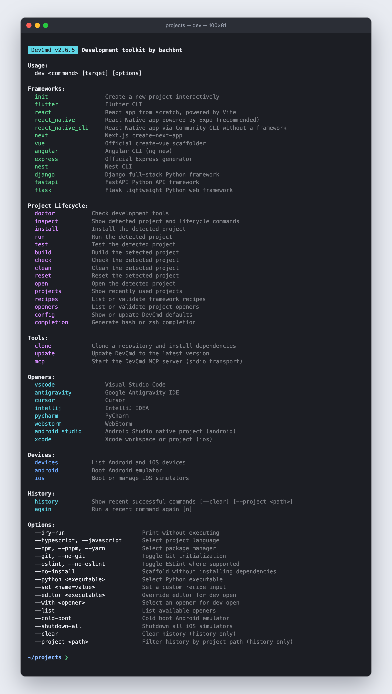

# DevCmd

DevCmd is an interactive development CLI for scaffolding projects, detecting existing projects, running common lifecycle tasks, and managing Android emulators and iOS simulators.

[](https://www.npmjs.com/package/@bachbntdev/devcmd)
[](https://github.com/bachbnt/dev-cmd/actions/workflows/ci.yml)

[Install from npm](https://www.npmjs.com/package/@bachbntdev/devcmd) | [Download the latest DevCmd release](https://github.com/bachbnt/dev-cmd/releases/latest) | [View all releases](https://github.com/bachbnt/dev-cmd/releases)

## Features

- Scaffold JavaScript, mobile, and Python web projects with framework-appropriate defaults.
- Pass project or device targets directly, or use interactive prompts.
- Preview commands with `--dry-run`.
- Select TypeScript/JavaScript, package manager, Git, and ESLint where supported.
- Inspect device runtime and boot status.
- Cold boot Android emulators and shut down all iOS simulators.
- View command history, repeat any recent command, and filter by project.
- Detect Node.js, Python, Flutter, Android, and iOS projects from any child directory.
- Use consistent `install`, `run`, `test`, `build`, `clean`, `reset`, and `open` commands.
- Inspect detected projects and their resolved lifecycle commands before execution.
- Run framework-aware quality checks with one `dev check` command.
- Add trusted user-defined framework recipes without changing DevCmd source.
- Check the local toolchain with `dev doctor`.
- Store defaults and recently used projects under `~/.devcmd`.
- Target one package in a monorepo with `--filter`.
- Lint, format, audit, and upgrade dependencies with the same lifecycle commands.
- Define project-specific commands and tasks in a trusted `.devcmd.json`.
- Run an action in several projects at once with `dev parallel`.
- Manage `.env` files and Docker Compose from the same CLI.
- Print machine-readable output with `--json`.
- Let AI agents scaffold, inspect, run, and monitor projects through the built-in MCP server.

## Screenshots

| Interactive framework picker (`dev init`) | Interactive options (`dev next`) |
|:-:|:-:|
|  |  |

| Preview with `--dry-run` | Toolchain check (`dev doctor`) |
|:-:|:-:|
|  |  |

| Android and iOS devices (`dev devices`) | Framework recipes (`dev recipes`) |
|:-:|:-:|
|  |  |

<details>
<summary>All commands (<code>dev help</code>)</summary>



</details>

## Requirements

- Node.js 20.12 or newer, including npm. CI covers Node.js 20, 22, and 24.
- Android Studio is only required for Android emulator features.
- Xcode is only required for iOS simulator features.
- Framework SDKs are only required for the frameworks you use, such as Flutter or Python.

## Installation

### Install from npm

DevCmd is published on npm as the scoped package [`@bachbntdev/devcmd`](https://www.npmjs.com/package/@bachbntdev/devcmd) (available since 2.7.1). The unscoped registry package named `devcmd` belongs to a different project, so always include the scope:

```bash
npm install --global @bachbntdev/devcmd
dev help
dev doctor
```

Run it without installing:

```bash
npx @bachbntdev/devcmd doctor
```

Update with `dev update` (it runs `npm install --global @bachbntdev/devcmd@latest`). Remove it with:

```bash
npm uninstall --global @bachbntdev/devcmd
```

If you installed an older release from a GitHub archive, it was registered as `devcmd`. Remove it first with `npm uninstall --global devcmd`.

### Download from GitHub

Open the latest GitHub Release to view release notes and downloadable source archives:

[Download the latest release](https://github.com/bachbnt/dev-cmd/releases/latest)

Downloading an archive does not install the CLI automatically. To install straight from GitHub instead of the npm registry, use npm with a GitHub URL below. No repository clone is required.

### Install the current source

Install the newest committed source from the `main` branch. This is the installation that matches the current README:

```bash
npm install --global https://github.com/bachbnt/dev-cmd/archive/refs/heads/main.tar.gz
```

The installation provides both `dev` and `devcmd`. Verify the CLI and inspect the tools available on your machine:

```bash
dev help
dev doctor
```

You can use the full command name if `dev` conflicts with another executable:

```bash
devcmd help
```

No repository checkout, `chmod`, `npm link`, or shell `source` command is needed.

When this repository is already available on macOS, double-click `commands/install-remote.command` in Finder to load the newest available source, then verify it with `dev help` and `dev doctor`. If the checkout has local or unpushed changes, the launcher links that source; otherwise it installs GitHub `main`.

### Install a tagged release

<!-- devcmd-release-version:start -->
For a reproducible released snapshot, install a specific GitHub tag. The tag matching the current package version is `v2.7.1`:

```bash
npm install --global https://github.com/bachbnt/dev-cmd/archive/refs/tags/v2.7.1.tar.gz
```
<!-- devcmd-release-version:end -->

Tagged releases can predate features documented on `main`. Check [GitHub Releases](https://github.com/bachbnt/dev-cmd/releases) for newer tags and release notes. These archive URLs do not require Git.

### Update or uninstall

Run `dev update`, install a newer release tag, or run the `main` installation command again to update DevCmd. To remove a copy installed from a GitHub archive:

```bash
npm uninstall --global @bachbntdev/devcmd
```

Repository contributors can also double-click `commands/install-remote.command` instead of entering setup or update commands manually.

When using NVM, global npm packages belong to the active Node.js version. Install DevCmd once for each Node.js version where it should be available. If the command is not found immediately after installation, open a new terminal and check the active npm prefix with `npm config get prefix`.

### Alternative GitHub syntax

If Git is installed, npm also accepts this shorter syntax for the latest source on `main`:

```bash
npm install --global github:bachbnt/dev-cmd
```

### Local development only

Cloning is only needed when contributing to DevCmd itself. Clone the repository, then run the reusable setup script:

```bash
git clone https://github.com/bachbnt/dev-cmd.git
cd dev-cmd
./scripts/install-local.sh
# or
npm run install-local
```

The setup installs dependencies and creates an npm symlink from the active Node.js installation to the local repository. Run it once; later source changes are used automatically the next time `dev` runs, without `source ~/.zshrc` or relinking.

## Usage

```bash
dev <command> [target] [options]
# or
devcmd <command> [target] [options]
```

Interactive project creation with framework selection:

```bash
dev init
```

Interactive project creation for a specific framework:

```bash
dev next
```

Direct, non-interactive project creation:

```bash
dev react my-app --typescript --pnpm --git
dev next my-app --typescript --npm --eslint
dev angular my-app --pnpm --git
dev vue my-app --javascript --yarn --no-eslint
dev django my-app
dev fastapi my-api
dev flask my-app
```

Preview without executing:

```bash
dev flutter demo --dry-run
```

Check installed development tools and see how to install the missing ones:

```bash
dev doctor
```

Inspect the current project without executing anything:

```bash
dev inspect
dev inspect ../my-project
```

## Framework Commands

| Command | Scaffolder |
| --- | --- |
| `flutter` | `flutter create` |
| `react` | Vite React template for apps built from scratch |
| `react_native` | Expo via `create-expo-app` (recommended) |
| `react_native_cli` | React Native Community CLI without a framework |
| `next` | `create-next-app` |
| `vue` | Official `create-vue` |
| `angular` | Angular CLI (`ng new`) |
| `express` | Official `express-generator` |
| `nest` | Nest CLI |
| `django` | Official Django `startproject` inside a local virtual environment |
| `fastapi` | Minimal FastAPI package with tests and `pyproject.toml` |
| `flask` | Flask application factory with tests and `pyproject.toml` |

Direct targets use recommended defaults: TypeScript, npm, Git, and ESLint where the selected scaffolder supports them. Run a framework command without a target to configure supported presets interactively.

React recommends using a framework for new production applications. Use `dev next` for a full-stack React framework, or `dev react` when a client-side Vite application is the right fit. React Native recommends a framework, so `dev react_native` uses Expo; use `dev react_native_cli` only when framework constraints do not fit the project.

Angular CLI scaffolds a full TypeScript workspace via `ng new`. DevCmd forwards the package manager and Git flags directly; TypeScript is Angular's default and is not a separate option.

Python projects create a local `.venv`, install their declared dependencies, and include development instructions in the generated README. Django uses the official project generator; FastAPI and Flask use small DevCmd templates based on their official recommended layouts.

```bash
dev django my-app
dev fastapi my-api --no-git
dev flask my-app
```

```bash
dev react web-app --typescript --pnpm
dev react_native mobile-app --typescript --pnpm
dev react_native_cli NativeApp --yarn
```

Skip dependency installation where supported:

```bash
dev next web-app --no-install
dev fastapi my-api --no-install
dev django my-app --python python3.13
```

## Project Lifecycle

Run these commands from a project root or any child directory:

```bash
dev install
dev run
dev test
dev build
dev check
dev lint
dev format
dev outdated
dev upgrade
dev audit
dev clean
dev reset
dev open
```

| Action | Node.js | Python | Flutter |
| --- | --- | --- | --- |
| `lint` | `lint` script (`lint:fix` with `--fix`) | `ruff check` (`--fix`) | `flutter analyze` |
| `format` | `format` script | `ruff format` | `dart format .` |
| `outdated` | `<pm> outdated` | `pip list --outdated` | `flutter pub outdated` |
| `upgrade` | `<pm> update` (`yarn upgrade`) | `pip install --upgrade -e .[dev]` | `flutter pub upgrade` |
| `audit` | `<pm> audit` (`yarn npm audit` on Yarn Berry) | `pip_audit` | not supported |

`dev outdated` exits with code 1 under npm when outdated packages exist; that is npm behavior, not a DevCmd failure.

`dev reset` removes the dependency directory (`node_modules` or `.venv`) and reinstalls from scratch. Flutter runs `flutter clean` then `flutter pub get`. iOS runs `xcodebuild clean` then resolves package dependencies.

You can also pass a project path:

```bash
dev test ../my-api
dev build ~/Projects/my-app
dev open cursor ~/Projects/my-app
```

DevCmd detects projects using files such as `package.json`, `pyproject.toml`, `manage.py`, `pubspec.yaml`, `gradlew`, `.xcworkspace`, and `.xcodeproj`. Node package managers are selected from lockfiles. Node lifecycle commands use the project's `package.json` scripts; Python commands prefer the project's `.venv`.

`dev inspect` reports the detected type, root, package manager, and the exact command resolved for every lifecycle action. Unsupported actions are shown with a reason instead of failing the whole inspection.

`dev check` runs the quality sequence supported by the detected project:

- Node.js: available `lint`, `typecheck`, `test`, then `build` scripts
- Python: Ruff when configured, then pytest and package build
- Flutter: analyze then test
- Android: Gradle lint and test
- iOS: Xcode analyze and build

Current native defaults:

- Flutter build: `flutter build apk`
- Android run/install: `./gradlew installDebug`
- Android build: `./gradlew assembleDebug`
- iOS build/test/clean: `xcodebuild` with the detected workspace or project
- iOS automatic run is intentionally not provided because it requires an explicit scheme and destination

### Monorepos and Workspaces

DevCmd detects npm, Yarn, and pnpm workspaces (`workspaces` in `package.json` or `pnpm-workspace.yaml`). `dev inspect` lists them. Target one workspace with `--filter`, using its package name, directory, or directory name:

```bash
dev test --filter @acme/web
dev run --filter web
dev lint --filter apps/api --fix
dev check --filter web
```

`--filter` works with `run`, `test`, `build`, `check`, `lint`, `format`, and `task`. It resolves to `npm run <script> --workspace <name>`, `pnpm --filter <name> run <script>`, or `yarn workspace <name> run <script>`, and checks the selected workspace's scripts. Without `--filter`, the commands run in the repository root.

### Tasks

`dev task` lists the tasks DevCmd can run: tasks from `.devcmd.json` first, then `package.json` scripts. Run one by name:

```bash
dev task
dev task seed
dev task seed ../my-api
dev task migrate --filter api
```

### Project Profile (`.devcmd.json`)

A `.devcmd.json` file at the project root overrides lifecycle actions and defines tasks. It also lets DevCmd drive projects it cannot detect, such as a Go or Make based repository (the project type is `custom`). Commands use the same structured `run` actions as recipes: separate `executable` and `args`, no shell, and the placeholders `{root}`, `{packageManager}`, and `{python}`.

```json
{
  "name": "my-service",
  "lifecycle": {
    "run": [{ "type": "run", "executable": "go", "args": ["run", "./cmd/server"], "cwd": "{root}" }],
    "test": [{ "type": "run", "executable": "go", "args": ["test", "./..."], "cwd": "{root}" }]
  },
  "tasks": {
    "seed": {
      "description": "Load sample data",
      "commands": [{ "type": "run", "executable": "go", "args": ["run", "./cmd/seed"], "cwd": "{root}" }]
    }
  }
}
```

Actions that the profile does not define fall back to the detected project type. A profile executes commands, so DevCmd never runs it until you approve it:

```bash
dev trust            # shows every command, then asks for confirmation
dev trust --yes      # approve without the prompt
```

Approval is stored in `~/.devcmd/trusted.json` together with a hash of the file. Changing the file requires approval again. Shell executables such as `bash` or `cmd` are rejected, as in recipes. `dev inspect` shows whether the profile is trusted.

### Parallel Execution

Run one lifecycle action in several projects at once. Output lines are prefixed with the project name and Ctrl+C stops every child process:

```bash
dev parallel run ./api ./web
dev parallel test ./api ./web ./worker
dev parallel build ./api ./web --dry-run
```

### Environment Files

```bash
dev env              # create .env from .env.example, .env.sample, or .env.template (never overwrites)
dev env check        # report variables missing from .env; exits 1 when any are missing
dev env check ../my-api
```

Variable values are never printed.

### Docker Compose

```bash
dev docker up        # docker compose up -d
dev docker logs
dev docker down
dev docker build ./services/api
```

Supported actions are `up`, `down`, `build`, `ps`, `logs`, and `restart`. DevCmd looks for `compose.yaml`, `compose.yml`, `docker-compose.yaml`, or `docker-compose.yml`.

### JSON Output

Add `--json` to print machine-readable JSON on stdout for `inspect`, `doctor`, `projects`, `history`, `recipes`, `openers`, `devices`, and `config`. Errors are written to stderr as `{"error": "..."}` and the exit code is 1. `dev doctor --json` exits 1 when a required tool is missing.

```bash
dev inspect --json | jq '.actions[] | select(.available) | .command'
dev doctor --json
```

### Continuous Integration

The repository provides a composite GitHub Action that runs a DevCmd command in your workflow:

```yaml
- uses: actions/checkout@v4
- uses: actions/setup-node@v4
  with:
    node-version: 22
- uses: bachbnt/dev-cmd@main
  with:
    command: check
    path: .
```

`dev check` returns the failing command's exit code, so the step fails when linting, type checking, tests, or the build fail.

### Project Openers

`dev open` uses Visual Studio Code by default. Select another built-in opener with a short positional name:

```bash
dev open
dev open cursor
dev open pycharm ~/Projects/my-api
dev open webstorm ./frontend
```

Built-in openers:

| Name | Description | Aliases |
| --- | --- | --- |
| `vscode` | Visual Studio Code | |
| `antigravity` | Google Antigravity IDE | |
| `cursor` | Cursor | |
| `intellij` | IntelliJ IDEA | |
| `pycharm` | PyCharm | |
| `webstorm` | WebStorm | |
| `android_studio` | Android Studio native project | `android` |
| `xcode` | Xcode workspace or project | `ios` |

Android Studio automatically prefers the detected project's `android/` directory. Xcode opens a detected `.xcworkspace` before `.xcodeproj` and is available only on macOS.

```bash
dev open android
dev open ios
dev open --list
```

Use `--with` when a path could be confused with an opener name, or use the legacy executable override when an unregistered editor is already available in `PATH`:

```bash
dev open ./cursor --with vscode
dev open ./project --editor my-editor
```

Custom openers are loaded from `~/.devcmd/openers/*.json`. Validate and install one without modifying DevCmd source:

```bash
dev openers validate ./fleet.json
mkdir -p ~/.devcmd/openers
cp ./fleet.json ~/.devcmd/openers/
dev open fleet ./my-project
```

Example `fleet.json`:

```json
{
  "name": "fleet",
  "description": "JetBrains Fleet",
  "target": "project",
  "platforms": {
    "darwin": {
      "executable": "open",
      "args": ["-a", "Fleet", "{target}"]
    },
    "linux": {
      "executable": "fleet",
      "args": ["{target}"]
    }
  }
}
```

Supported platforms are `darwin`, `linux`, and `win32`. Supported targets are `project`, `android`, and `xcode`; placeholders are `{target}`, `{root}`, and `{platform}`. Commands always use separate executable and argument arrays. Shell executables and executable placeholders are rejected. A custom opener with the same canonical name overrides its built-in definition.

## Device Commands

```bash
dev devices
dev android Pixel_9_Pro_Fold
dev android Pixel_9_Pro_Fold --cold-boot
dev ios "iPhone 17 Pro"
dev ios --shutdown-all
```

`dev devices` shows device name, runtime, and `Booted`/`Shutdown` status.

The standalone `dev android` and `dev ios` commands manage devices. They do not create native source projects.

## Configuration

DevCmd stores user defaults in `~/.devcmd/config.json`:

```bash
dev config
dev config set packageManager pnpm
dev config set initializeGit false
dev config set python python3.13
dev config set opener cursor
dev config set notify 10
```

`notify` sets the notification threshold in seconds. DevCmd sends a system notification when a command runs longer than the threshold. Set to `0` to disable (default).

Default configuration:

```json
{
  "packageManager": "npm",
  "initializeGit": true,
  "python": "python3",
  "opener": "vscode",
  "notify": 0
}
```

## Recent Projects

Successful scaffold and lifecycle commands register projects in `~/.devcmd/projects.json`:

```bash
dev projects
dev open recent
```

## Clone and Update

Clone a repository and automatically install its dependencies:

```bash
dev clone owner/repo
dev clone owner/repo my-dir
dev clone https://github.com/owner/repo
dev clone git@github.com:owner/repo.git
```

`owner/repo` is treated as a GitHub shorthand. DevCmd detects the project type after cloning and runs `dev install` automatically.

Update DevCmd to the latest version from npm:

```bash
dev update
```

## Shell Completion

Generate completion for the current shell:

```bash
dev completion zsh > ~/.zfunc/_dev
dev completion bash > ~/.devcmd-completion.bash
```

For Zsh, ensure `~/.zfunc` is included in `fpath`. For Bash, source the generated file from `.bashrc`. Completion generation itself prints a pure shell script, so it can also be evaluated or managed by a dotfiles tool.

The generated completion registers both executable names: `dev` and `devcmd`.

## History

```bash
dev history
dev history --clear
dev history --project ~/Projects/my-app
dev history --search next
dev again
dev again 3
dev again --dry-run
```

The latest 50 successful commands are stored in `~/.devcmd/history.json`.

`dev again <n>` repeats the nth entry shown by `dev history`. `dev history --clear` deletes the history file. `dev history --project <path>` filters entries by project path and `dev history --search <text>` filters by text in the command, project name, or type. Filters can be combined.

History entries store executables and argument arrays instead of shell command strings. Compatible older entries are rebuilt from their saved metadata before `dev again` runs them.

## Options

```text
--dry-run
--typescript, --ts
--javascript, --js
--package-manager <npm|pnpm|yarn>, --pm <npm|pnpm|yarn>
--npm, --pnpm, --yarn
--git, --no-git
--eslint, --no-eslint
--install, --no-install
--python <executable>
--editor <executable>
--with <opener>
--list
--filter <workspace>        (run, test, build, check, lint, format, task)
--fix                       (lint only) Apply automatic fixes
--json                      (inspect, doctor, projects, history, recipes, openers, devices, config)
--yes, -y                   (trust only) Approve without the prompt
--set <name=value>
--cold-boot
--shutdown-all
--clear                     (history only) Delete the history file
--project <path>            (history only) Filter history by project path
--search <text>             (history only) Filter history by text
```

## Development

DevCmd does not execute generated commands through a shell. Every executable and argument is passed separately to Node.js `spawn`, and multi-step operations such as scaffolding followed by `git init` run as separate processes.

```text
dev                         CLI entry point
commands/                   macOS double-click launchers
  install-local.command     Link local source via npm
  install-remote.command    Install latest source from GitHub
  release.command           Create a GitHub release interactively
scripts/                    Shell and Node.js automation scripts
src/cli.js                  Prompt and command orchestration
src/constants.js            Shared command name lists
src/commands/               Framework, device, and history commands
src/config/                 Branding, version, user paths, and defaults
src/devices/                Android and iOS discovery
src/generators/             Node.js scripts invoked as child processes
src/handlers/               CLI command handlers
src/openers/                Built-in and custom project opener engine
src/projects/               Detection, workspaces, .devcmd.json profiles, lifecycle adapters, recent projects
src/recipes/                Built-in and custom framework recipe engine
src/mcp/                    MCP server, tools, and background process manager
.github/workflows/          CI (Node 20/22/24) and npm publish workflows
action.yml                  Composite GitHub Action for dev check
src/runtime/                Shared command execution flow
src/runner/                 Command formatting and process execution
src/utils/                  Argument parsing and validation
test/                       Node.js unit tests
```

Run the test suite with:

```bash
npm test
```

### Release

Create a release interactively and choose `patch`, `minor`, `major`, the current version, or a custom semantic version:

```bash
npm run release
```

On macOS, double-click `commands/release.command` in Finder to open Terminal and choose either a real release or a dry-run preview. The launcher runs the release through a Zsh login shell so Node.js, NVM, and GitHub CLI remain available without loading Zsh configuration inside Bash. It keeps the window open after an error so the message can be reviewed.

The release script validates Git and GitHub CLI state, checks that local `main` is not behind `origin/main`, runs tests and package validation, updates `package.json`, `package-lock.json`, and the tagged-install version in this README, commits all current changes, creates an annotated tag, pushes the branch and tag, and creates a GitHub Release with generated notes.

Use a specific increment or version for automation:

```bash
npm run release -- patch
npm run release -- minor
npm run release -- 3.0.0
```

Preview all checks and the release plan without changing the repository or publishing anything:

```bash
npm run release -- patch --dry-run
```

Pass `--yes` for a non-interactive release or `--draft` to create a draft GitHub Release.

Publishing a GitHub Release triggers `.github/workflows/publish.yml`, which checks that the tag matches `package.json`, runs the tests, and runs `npm publish --provenance --access public`. Add an npm automation token as the repository secret `NPM_TOKEN` before the first release; without it the workflow skips publishing with a warning and can be re-run after the secret is added. Draft releases do not publish. The `gh` CLI must be installed and authenticated with `gh auth login`.

`SIGINT` and `SIGTERM` are forwarded to the active child process. DevCmd preserves child exit codes, uses `127` for missing executables, and uses conventional signal exit codes such as `130` for `SIGINT`.

Lifecycle behavior is implemented through project adapters under `src/projects/adapters/`. Detection, inspection, and execution all use the same adapters, preventing displayed commands from drifting away from commands that actually run.

## Custom Framework Recipes

All default framework commands are built-in recipes stored in `src/recipes/built-ins.json`. User recipes use the same validation, placeholder resolver, structured process execution, detection, and lifecycle pipeline. DevCmd does not load project-local recipes automatically; only recipes placed in the trusted user directory are discovered:

```text
~/.devcmd/recipes/*.json
```

List active recipes and their source:

```bash
dev recipes
```

Validate a recipe before installing it:

```bash
dev recipes validate ./my-backend.json
mkdir -p ~/.devcmd/recipes
cp ./my-backend.json ~/.devcmd/recipes/
```

A minimal multi-step recipe can define inputs, safe file actions, executable requirements, detection rules, and lifecycle commands:

```json
{
  "name": "my_backend",
  "description": "Example custom backend",
  "capabilities": { "git": true },
  "inputs": {
    "module": {
      "description": "Module identifier",
      "required": true
    }
  },
  "requirements": [
    "node",
    "tool-cli",
    { "value": "git", "when": { "option": "git", "equals": true } }
  ],
  "actions": [
    { "type": "mkdir", "path": "." },
    { "type": "write", "path": ".devcmd-recipe", "content": "my_backend\n" },
    {
      "type": "run",
      "executable": "tool-cli",
      "args": ["init", "--module", "{module}"],
      "cwd": "{target}"
    }
  ],
  "detect": {
    "priority": 10,
    "rules": [{ "files": [".devcmd-recipe"] }]
  },
  "lifecycle": {
    "run": [{ "type": "run", "executable": "tool-cli", "args": ["run"], "cwd": "{root}" }],
    "test": [{ "type": "run", "executable": "tool-cli", "args": ["test"], "cwd": "{root}" }],
    "build": [{ "type": "run", "executable": "tool-cli", "args": ["build"], "cwd": "{root}" }]
  }
}
```

Run it like a built-in framework:

```bash
dev my_backend my-api --set module=example.com/my-api --dry-run
dev my_backend my-api --set module=example.com/my-api
```

Supported scaffold and lifecycle action types are `run`, `mkdir`, `write`, and `copy`. File destinations are restricted to the target project, `copy` sources must remain inside the recipe directory, and existing files are not overwritten. Recipe commands never use `shell: true` or shell command strings. A user recipe with the same name overrides its built-in recipe.

## MCP Server

DevCmd exposes an [MCP (Model Context Protocol)](https://modelcontextprotocol.io) server so AI agents such as Claude Code and Codex can call DevCmd tools directly without spawning shell commands.

### Setup

Inside this repository the server is discovered automatically through `.mcp.json`. For any other project, register it with an agent. With DevCmd installed globally:

```json
{
  "mcpServers": {
    "devcmd": { "command": "dev", "args": ["mcp"] }
  }
}
```

Without a global installation, let `npx` fetch it on demand:

```json
{
  "mcpServers": {
    "devcmd": { "command": "npx", "args": ["-y", "@bachbntdev/devcmd", "mcp"] }
  }
}
```

Claude Code can add it with `claude mcp add devcmd -- npx -y @bachbntdev/devcmd mcp`. Agents spawn `dev mcp` on demand and shut it down when the session ends; background processes are stopped with it.

### Tools

| Tool | Description |
| --- | --- |
| `inspect_project` | Project type, package manager, workspaces, tasks, profile trust state, and the exact command for every lifecycle action. |
| `run_lifecycle` | Run `install`, `run`, `test`, `build`, `check`, `lint`, `format`, `outdated`, `upgrade`, `audit`, `clean`, `reset`, or `open`. Supports `filter`, `fix`, `dryRun`, `timeoutMs`, and `maxOutputBytes`. Returns JSON with `ok`, `exitCode`, `output`, and `timedOut`. |
| `run_task` | Run a `.devcmd.json` task or `package.json` script. |
| `start_process` | Start a lifecycle action, such as a dev server, in the background and return a process id. |
| `get_process_logs` | Status and the latest output lines of a background process. |
| `stop_process` | Stop a background process. |
| `list_processes` | List background processes. |
| `scaffold_project` | Create a project from a recipe. `dryRun` defaults to `true`; review the command, then call again with `dryRun: false`. |
| `list_frameworks` | Recipes with their supported options. |
| `doctor` | Installed tools and install hints. |
| `list_devices` | Android emulators and iOS simulators. |
| `boot_device` | Boot an Android emulator (background process) or an iOS simulator. |
| `get_history` | Recent successful commands, filterable by `project` and `search`. |

Failed commands are returned with `isError: true` so agents can react to them. Profile commands from `.devcmd.json` are refused until you run `dev trust` yourself; the MCP server has no tool for approving a profile.

### Running manually

`dev mcp` starts the server on stdio and blocks waiting for JSON-RPC input. This is only useful for debugging; in normal use the agent manages the process lifecycle.

```bash
dev mcp
```

## AI Agent Skills

DevCmd keeps reusable AI instructions in a vendor-neutral directory:

```text
.ai/skills/                 Canonical skill source
.claude/skills              Claude Code discovery link
.agents/skills              Codex discovery link
AGENTS.md                   Independent Codex instructions
CLAUDE.md                   Independent Claude Code instructions
```

`AGENTS.md` and `CLAUDE.md` do not import or reference each other. Each agent has independent project instructions, while both discovery directories point to `.ai/skills` so Claude Code and Codex use the same canonical skill content.

Each skill uses a portable `SKILL.md` as its required entrypoint. Vendor-specific UI metadata is intentionally omitted so the same skill directories remain neutral between Claude Code and Codex.

These AI instruction files are contributor tooling stored in the GitHub repository. They are not included in the globally installed CLI package produced by `npm pack`.

| Skill | Purpose |
| --- | --- |
| `devcmd-add-framework` | Add framework scaffolding end to end using current official practices. |
| `devcmd-add-lifecycle-adapter` | Add project detection and lifecycle command resolution. |
| `devcmd-review-command-safety` | Audit input validation, child processes, history, and cleanup safety. |
| `devcmd-add-device-provider` | Extend device discovery and control without requiring real devices in tests. |
| `devcmd-debug-cli` | Reproduce, classify, fix, and regression-test CLI failures. |
| `devcmd-release-check` | Validate versioning, packaging, tags, installation, and GitHub releases. |
| `devcmd-update-docs` | Keep README, help, completion, examples, and installation guidance aligned. |
