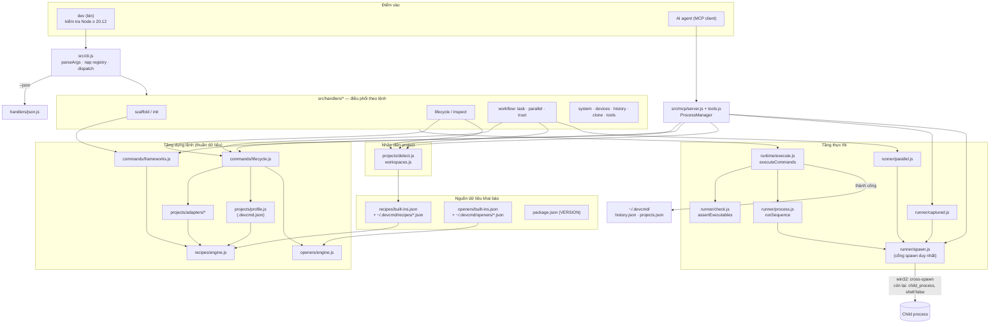
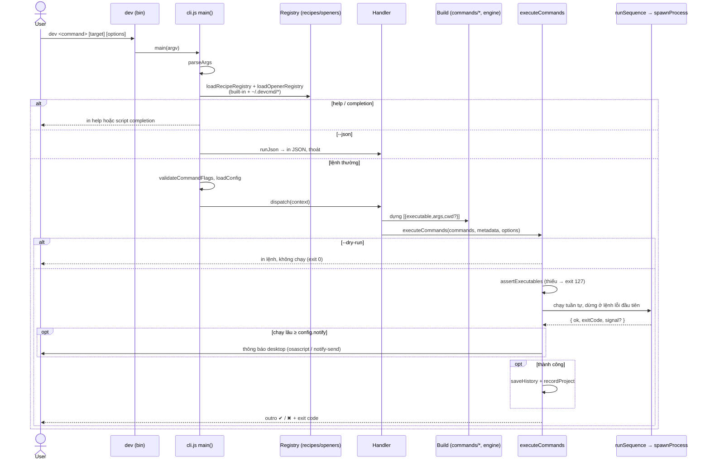
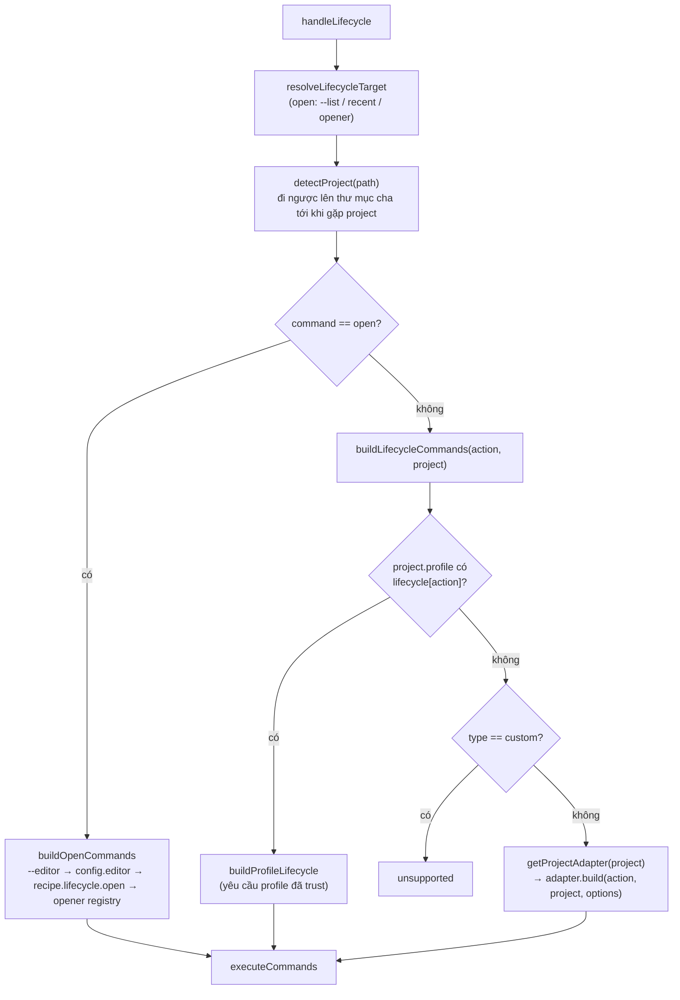
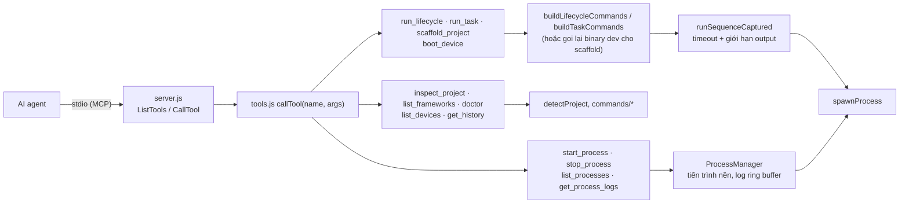

# Kiến trúc & luồng chạy của DevCmd

DevCmd là CLI Node.js (CommonJS, `node >= 20.12`) dùng để scaffold project và chạy các lệnh vòng đời phát triển (install, run, test, build...). Có hai cách dùng chung một lõi: **CLI** (`dev` / `devcmd`) và **MCP server** (`dev mcp`) cho AI agent.

Nguyên tắc xuyên suốt: mọi hành động đều được **biểu diễn thành dữ liệu** `{ executable, args, cwd? }` (không dùng shell, không nối chuỗi), rồi mới được thực thi qua một cổng duy nhất.

## 1. Tổng quan các tầng

## 2. Cấu trúc thư mục

| Thư mục | Vai trò |
| --- | --- |
| `dev` | Bin: kiểm tra phiên bản Node, gọi `main()` trong `src/cli.js`, set `process.exitCode`. |
| `src/cli.js` | Parse argv, nạp recipe/opener registry, validate flag, nạp config, `dispatch` tới handler. Cũng chứa `printHelp`. |
| `src/utils/args.js` | `parseArgs`, `validateCommandFlags`, `validateFrameworkOptions`, `validateProjectName`. |
| `src/constants.js` | Danh sách lệnh: `LIFECYCLE_COMMANDS`, `SYSTEM_COMMANDS`, `DEVICE_COMMANDS`, `FILTER_COMMANDS`, `JSON_COMMANDS`. |
| `src/config/` | Hằng số đường dẫn `~/.devcmd/*`, `VERSION` (đọc từ `package.json`), `frameworkDefinitions` (sinh từ recipe); `user.js` đọc/ghi config người dùng. |
| `src/handlers/` | Mỗi lệnh CLI một handler: `scaffold`, `lifecycle`, `workflow` (task/parallel/trust), `system` (doctor/config/recipes/openers/projects/update), `devices`, `history`, `clone`, `tools` (env/docker), `json`, `mcp`. |
| `src/commands/` | Hàm thuần dựng danh sách lệnh: `frameworks`, `lifecycle`, `inspect`, `devices`, `history`, `env`, `docker`, `completion`. |
| `src/recipes/` | **Recipe engine**: `loader` (built-in + user), `schema` (validate), `engine` (nội suy → command), `action-runner.js` (mkdir/write/copy chạy như child process). Dữ liệu ở `built-ins.json`. |
| `src/openers/` | **Opener engine** cho `dev open`: `loader`, `schema`, `engine`; dữ liệu ở `built-ins.json` (giữ alias `android`, `ios`). |
| `src/projects/` | `detect.js` (nhận diện project), `adapters/` (node, python, flutter, android, ios, recipe), `profile.js` (`.devcmd.json` + trust), `workspaces.js` (monorepo), `recent.js` (project gần đây). |
| `src/runner/` | `command.js` (kiểu command), `spawn.js` (cổng spawn), `process.js` (chạy tuần tự, forward signal), `parallel.js`, `captured.js` (thu output cho MCP), `check.js` (kiểm tra executable/doctor). |
| `src/runtime/execute.js` | `executeCommands`: dry-run → kiểm tra yêu cầu → chạy → thông báo → lưu history/project. |
| `src/devices/` | Liệt kê Android emulator, iOS simulator. |
| `src/generators/` | Script nội bộ (python-project, clean-project, reset-project) được chạy như child process. |
| `src/mcp/` | MCP server stdio: `server.js`, `tools.js` (định nghĩa + `callTool`), `processes.js` (`ProcessManager` cho tiến trình nền). |
| `test/` | `node --test`, mỗi module một file test. |
| `.ai/skills`, `.claude/skills` | Skill AI dùng lại cho dự án (symlink). |
| `scripts/`, `.github/workflows/` | Cài đặt, release, CI, publish npm. |

## 3. Luồng chính của CLI

Điểm cần nhớ khi `dispatch` (`src/cli.js`):
1. Tra `COMMAND_HANDLERS` (config, doctor, inspect, history, again, task, parallel, trust, env, docker, devices, android, ios, mcp... và toàn bộ `LIFECYCLE_COMMANDS` → `handleLifecycle`).
2. Nếu tên lệnh là **tên recipe** (react, next, django, flutter...) → `handleScaffold`. Không có nhánh riêng cho từng framework trong CLI.
3. Ngược lại → báo `Unsupported command`.

```mermaid
flowchart LR
    A["dev react my-app<br/>hoặc dev init"] --> B["handleScaffold"]
    B --> C["Hỏi tên project<br/>(nếu thiếu --target)"]
    C --> D["promptFrameworkOptions<br/>(language, PM, git, eslint, inputs bắt buộc)"]
    D --> E["applyConfigDefaults<br/>+ validateFrameworkOptions"]
    E --> F["buildFrameworkCommands<br/>→ recipes/engine.buildRecipeCommands"]
    F --> G["createContext + resolveInputs<br/>nội suy {target}, map theo option,<br/>lọc action theo when"]
    G --> H["Danh sách command:<br/>run → executable thật<br/>mkdir/write/copy → node action-runner.js"]
    H --> I["executeCommands<br/>requirements = getFrameworkRequirements"]
```

## 4. Luồng scaffold (`dev <framework> <name>` / `dev init`)

- Recipe (`built-ins.json` hoặc `~/.devcmd/recipes/*.json`) khai báo: `capabilities`, `inputs`, `detect`, `lifecycle`, `requirements`, `actions`.
- Action `run` cấm shell executable (`sh`, `bash`, `cmd`, `powershell`...). Action file (`mkdir`/`write`/`copy`) bị ép nằm trong thư mục target (`ensureInside`), `copy` nguồn nằm trong thư mục recipe.
- `executeCommands` nhận `requirements` để kiểm tra executable có trong PATH trước khi chạy.

## 5. Luồng lifecycle (`dev run|test|build|... [path]`)

### Nhận diện project (`src/projects/detect.js`)
Duyệt từ thư mục hiện tại lên gốc, mỗi cấp thử theo thứ tự:
1. **Recipe `detect`** (sắp theo `priority` giảm dần; rule theo `files`, `dependencies`, `contains`).
2. Có `package.json` → `detectNodeType` (next, nuxt, nest, react_native, vue, react, express, node) + package manager từ lockfile + workspaces.
3. `pubspec.yaml` → flutter; `gradlew` → android; `.xcworkspace/.xcodeproj` → ios; `manage.py` / `pyproject.toml` → django, fastapi, flask, python.
4. Có `.devcmd.json` → gắn `profile`; nếu không có project nền thì thành `type: 'custom'`.

### Chọn adapter (`src/projects/adapters/index.js`)
- `recipe.lifecycle.adapter` chỉ định rõ (`node`, `python`, `flutter`...) → dùng adapter đó.
- Recipe có `lifecycle` mà không có `adapter` → adapter `recipe` (chạy `recipe.lifecycle[action]` qua recipe engine).
- Ngược lại → adapter đầu tiên có `matches(project)`.
- `--filter` chỉ cho Node workspace; `--fix` chỉ cho `lint`.

### `.devcmd.json` và cơ chế trust
Profile của project có thể định nghĩa `lifecycle` và `tasks` (chỉ action `run`). Vì là mã do repo cung cấp nên **phải `dev trust`** (lưu hash SHA-256 vào `~/.devcmd/trusted.json`); đổi nội dung file thì mất trust. `inspect` / `trust` xem trước bằng `previewUntrusted`.

## 6. Các luồng phụ

| Lệnh | Luồng |
| --- | --- |
| `dev task [name]` | `listTasks` (profile + `package.json` scripts) hoặc `buildTaskCommands` → `executeCommands`. |
| `dev parallel <action> ...` | Detect nhiều project → `runParallel` (mỗi job spawn riêng, output có prefix `[label]`, dừng đồng loạt khi nhận signal). |
| `dev inspect [path]` | `detectProject` → `inspectProject` liệt kê lệnh sẽ chạy cho từng action (kèm lý do nếu không khả dụng). |
| `dev history` / `dev again [n]` | Đọc `~/.devcmd/history.json`; `again` dùng `rebuildHistoryCommands` (ưu tiên command đã lưu, kiểm bằng `isCommandSequence`; entry cũ dựng lại từ recipe) rồi `executeCommands`. |
| `dev android` / `dev ios` / `dev devices` | `src/devices/*` liệt kê; `commands/devices.js` dựng lệnh boot/shutdown. |
| `dev doctor` | `checkTools(config)` kiểm tra executable, in version + gợi ý cài theo OS. |
| `dev recipes` / `dev openers` (`validate`) | Nạp registry (bỏ qua user dir khi `validate`), kiểm tra schema. |
| `dev env` / `dev docker` / `dev clone` | Dựng command tương ứng rồi qua `executeCommands`. |
| `dev update` | `npm install --global @bachbntdev/devcmd@latest` qua `executeCommands`. |
| `--json` | `runJson` → in JSON ra stdout (lỗi: `{error}` ra stderr). Hỗ trợ: inspect, doctor, projects, history, recipes, openers, devices, config. |

## 7. Luồng MCP server (`dev mcp`)

- Dùng lại đúng các hàm dựng lệnh của CLI, chỉ khác tầng thực thi: output được **thu lại** (`runner/captured.js`, có timeout và `maxOutputBytes`) thay vì `stdio: inherit`.
- Tiến trình dài (dev server) chạy qua `ProcessManager` (`start_process` → id `p1`, `p2`...; đọc log, dừng bằng SIGTERM rồi SIGKILL sau grace period).
- Khi server đóng hoặc process thoát → `defaultProcesses.stopAll()`.
- Mọi tool hỗ trợ `dryRun` ở những nơi có thể.

## 8. Ràng buộc an toàn tiến trình

- Command luôn là `{ executable, args, cwd? }`, `args` ép về string (`createCommand`); `formatCommand` chỉ để hiển thị.
- **Mọi** child process phải đi qua `src/runner/spawn.js`:
  - POSIX: `child_process.spawn(..., { shell: false })`.
  - Windows: `cross-spawn` để chạy được shim `.cmd/.bat` (npm, npx, pnpm, yarn, code, gradlew.bat); từ chối đối số chứa `%`, xuống dòng, ký tự null.
- `runProcess` forward `SIGINT`/`SIGTERM` tới child, trả exit code 130/143, `ENOENT` → 127.
- Recipe/profile không được dùng shell executable; file action bị giới hạn trong thư mục target.

## 9. Mở rộng — thêm ở đâu

| Muốn thêm | Sửa ở |
| --- | --- |
| Framework scaffold mới | `src/recipes/built-ins.json` (recipe engine tự lo), cập nhật test + README. **Không** thêm nhánh trong handler. |
| Opener mới cho `dev open` | `src/openers/built-ins.json` (giữ alias `android`, `ios`). |
| Loại project / lifecycle action mới | `src/projects/detect.js`, `src/projects/adapters/*`, `src/constants.js`. |
| Thiết bị mới | `src/devices/*`, `src/commands/devices.js`, `src/handlers/devices.js`. |
| Tool MCP mới | `src/mcp/tools.js` (tái dùng hàm dựng lệnh hiện có). |
| Recipe/opener riêng của người dùng | `~/.devcmd/recipes/*.json`, `~/.devcmd/openers/*.json` (không cần sửa code). |

## 10. Dữ liệu trạng thái ngoài repo

Tất cả nằm trong `~/.devcmd/`: `config.json` (mặc định người dùng), `history.json`, `projects.json`, `trusted.json`, `recipes/`, `openers/`.

## 11. Build, test, release

- Test: `npm test` (`node --test`), mỗi module có file test trong `test/`.
- CI: `.github/workflows/ci.yml`.
- Release: `scripts/release.sh` + `release-version.js` / `sync-release-version.js`; tạo GitHub Release thì `publish.yml` kiểm tra tag khớp `package.json` rồi publish lên npm.
